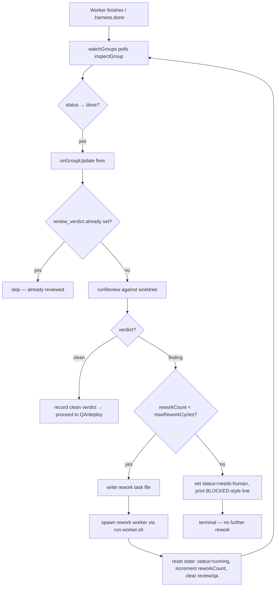

# Rework Loop — Implementation Plan

## Architecture Overview



## Detailed Changes by File

### 1. `src/orchestrator/state.ts` — Schema

Add to `OrchestratorGroup` (after `review_verdict` around line 58):

```ts
/** Rework cycle counter — incremented each time a review finding triggers a
 *  rework attempt. Absent (= 0) when the group has not been reworked. */
reworkCount?: number
```

Add `"needs-human"` to the status documentation comment on line 16 and 43.

### 2. `src/orchestrator/watch.ts` — Terminal status handling

**`isTerminal` helper** (inside `watchGroups`, line 382):
```ts
const isTerminal = (g: OrchestratorGroup): boolean =>
    g.status === "done" || g.status === "failed" || g.status === "needs-human"
```

**`printStatusTransition`** (around line 329): add a case for `"needs-human"`:
```ts
case "needs-human":
    write(`[orchestrate] NEEDS-HUMAN: group "${group.name}" exhausted ` +
        `${group.reworkCount ?? 0} rework attempt(s) — a human must look at this\n`)
    break
```

This mirrors the existing `BLOCKED:`/`DONE:`/`FAILED:` pattern established in the live-monitoring work.

### 3. `src/orchestrator/cli.ts` — All the orchestration logic

#### 3a. CLI option

Add to `OrchestrateOptions` interface:
```ts
/** Max rework cycles per group before giving up (default 3). */
maxReworkCycles: number
```

Default in `parseOrchestrateArgs`:
```ts
maxReworkCycles: 3,
```

Parsing (alongside `--max-concurrent-sessions`):
```ts
case "--max-rework-cycles": {
    const v = next()
    const n = v === undefined ? Number.NaN : Number(v)
    if (!Number.isInteger(n) || n <= 0) {
        return { options, error: "--max-rework-cycles requires a positive integer" }
    }
    options.maxReworkCycles = n
    break
}
```

Add to `ORCHESTRATE_USAGE`:
```
--max-rework-cycles <n>  Max automatic rework attempts per group when review
                         finds issues (default: 3). After the cap the group
                         is marked "needs-human" and left for manual resolution.
```

#### 3b. Rework task file content

New function `buildReworkTaskFileContent` exported from `cli.ts`:

```ts
export function buildReworkTaskFileContent(
    group: { name: string; issues?: number[] },
    findings: string[],
    reworkCount: number,
): string {
    const assigned = (group.issues ?? []).map((n) => `#${n}`).join(", ") || "this worktree"
    const ghLines = (group.issues ?? []).map((n) => `gh issue view ${n}`).join("\n")
    const findingsList = findings.map((f, i) => `${i + 1}. ${f}`).join("\n")
    
    return [
        `## Rework cycle ${reworkCount} — address review findings`,
        "",
        "The automated adversarial reviewer found problems with the prior attempt on this",
        `worktree (${group.name}). Your job: fix EVERY finding below, re-verify for real,`,
        "then re-close or update the issues with fresh evidence.",
        "",
        "## Review findings to fix",
        "",
        findingsList || "(no specific findings recorded — review the diff and re-verify everything)",
        "",
        `Assigned issues: ${assigned}. Fetch real issue bodies:`,
        "```",
        ghLines || "# (no issues recorded — inspect the worktree)",
        "```",
        "",
        "## Workflow",
        "",
        "1. Read each finding above and the relevant source files.",
        "2. Fix every finding — do not skip any.",
        "3. Re-verify: run the project's tests/boot check and capture real output.",
        "4. Commit with issue numbers referenced.",
        "5. Push and update the PR (or open a new one if needed).",
        "6. Post an updated closing comment using the required template structure:",
        "",
        "## Required comment template",
        "",
        "Your issue-closing comment must use this exact structure:",
        "```",
        "## Issue <n> — Closing Report (rework cycle <n>)",
        "",
        "### Files changed",
        "<one line per file>",
        "",
        "### Baseline (before)",
        "<real output>",
        "",
        "### Baseline (after)",
        "<real output>",
        "",
        "### Boot check",
        "<real output or exact reason it didn't apply>",
        "",
        "### Residual risk / notes",
        "<anything not 100% certain>",
        "",
        "PR: <link>",
        "```",
        "",
        "## Closing out",
        "",
        "Once every finding is addressed and every assigned issue is re-closed with fresh",
        "evidence, call attempt_completion with a full summary.",
        "",
        `Scope: ${assigned} — rework cycle ${reworkCount}. Address the findings above.`,
    ].join("\n")
}
```

The task file is written to `<repo>/plans/parallel-tasks/<name>-rework<n>.md` where `n` is the new rework count (1-indexed, matching the count of rework *attempts* — a group with `reworkCount: 0` that gets a finding produces `-rework1.md`, and its `reworkCount` becomes 1).

#### 3c. Rework spawn + state reset in `onGroupUpdate`

Replace the finding-recording block (lines 591-611 in current `cli.ts`) with the full rework logic. The key change is between recording the review result and the QA block.

Current flow (simplified):
```
1. runReview → result
2. Record review_verdict, pending_review_findings, reviewed_at, last_activity
3. (if --qa, check review pass and run QA)
```

New flow:
```
1. runReview → result
2. If verdict === "finding":
   a. Compute effective reworkCount = group.reworkCount ?? 0
   b. If effective < options.maxReworkCycles:
      i.   newReworkCount = effective + 1
      ii.  Write rework task file to <repo>/plans/parallel-tasks/<name>-rework<newReworkCount>.md
      iii. Spawn rework worker: bash scripts/run-worker.sh <worktree-path> <task-file-path> --mode <mode> --model <model>
      iv.  Update group state: increment reworkCount, status="running", clear review_verdict/pending_review_findings/reviewed_at/qa
      v.   Record last_activity noting rework attempt
   c. Else (at cap):
      i.   Update group: status="needs-human", keep review_verdict + findings for inspection
      ii.  Record last_activity noting exhausted rework
3. Else (verdict === "clean"): record as before (no reworkCount change)
4. (QA block unchanged — it already checks review_verdict === "clean" before running)
```

The rework spawn uses `spawnSync` with `"bash", ["-c", cmd]` pattern (matching existing style in `cli.ts` line 539). The command is:

```ts
const reworkTaskPath = path.join(repo, "plans", "parallel-tasks", `${group.name}-rework${newReworkCount}.md`)
const harnessRoot = HARNESS_ROOT_TS
const reworkSpawnCmd = `bash ${path.join(harnessRoot, "scripts", "run-worker.sh")} ` +
    `"${groupWorktreePath(repo, group)}" "${reworkTaskPath}" ` +
    `--mode "${options.mode}"` +
    (options.model ? ` --model "${options.model}"` : "")

const reworkResult = spawnSync("bash", ["-c", reworkSpawnCmd], {
    cwd: repo,
    env: {
        ...process.env,
        // run-worker.sh picks up HEADLESSCODE_ROOT from env; set it explicitly
        HEADLESSCODE_ROOT: harnessRoot,
        // Forward memory dir so the rework worker also has memory context
        ...(options.memoryDir ? { HEADLESSCODE_MEMORY_DIR: path.resolve(options.memoryDir) } : {}),
    },
    stdio: "inherit",
})
```

The watch loop will naturally pick up the group again because:
- `isTerminal` returns false for `status === "running"`
- `inspectGroup` polls the worktree for `.harness.done`
- When the rework worker finishes, `.harness.done` appears → `inspectGroup` returns `{ status: "done", ... }`
- `watchGroups` fires `onGroupUpdate` again → re-review runs

#### 3d. Exit code/summary

In the final summary block (around lines 668-678):

```ts
const needsHuman = finalState.groups.filter((g) => g.status === "needs-human")
if (needsHuman.length > 0) {
    process.stderr.write(
        `headlesscode orchestrate: ${needsHuman.length} group(s) need human attention ` +
        `after exhausting rework attempts: ${needsHuman.map((g) => g.name).join(", ")}\n`,
    )
    // Still exit 1 — this is a definite failure outcome
}

// Return non-zero if any group failed OR needs-human
if (failed.length > 0 || needsHuman.length > 0) {
    return 1
}
```

**`deployGateReady`** (around line 733): add a check for `"needs-human"` groups, same as `"failed"`:

```ts
const anyFailed = state.groups.some(
    (g) => g.status === "failed" || g.status === "needs-human"
)
```

### 4. Unit tests — `src/orchestrator/__tests__/cli.test.ts`

New test file following the established pattern (hand-rolled, no framework).

**Test cases:**

| # | Name | What it asserts |
|---|------|----------------|
| 1 | `buildReworkTaskFileContent includes findings and rework count` | The generated content contains the findings list, rework cycle number, and issue references |
| 2 | `buildReworkTaskFileContent handles empty findings gracefully` | No crash when findings array is empty; content includes fallback text |
| 3 | `finding verdict below cap triggers rework spawn and resets state` | After a finding verdict with reworkCount=0 and cap=3: reworkCount becomes 1, status="running", review_verdict cleared, qa cleared |
| 4 | `finding verdict at cap produces needs-human status, no spawn` | With reworkCount=3 and cap=3: status="needs-human", review_verdict preserved, no spawn command emitted |
| 5 | `clean verdict never touches reworkCount` | review_verdict="clean" → reworkCount stays undefined/0, no spawn |
| 6 | `multiple groups rework independently` | Two groups with different rework counts; one group's rework doesn't affect the other's count |

Tests 3-6 need to exercise the rework logic in isolation — they test the state transitions directly rather than calling the full `orchestrateMain`. The approach: extract the rework decision into an exported function (e.g., `handleReviewVerdict`) that takes `group`, `options`, `repo`, `state`, and returns the `{ patch, shouldSpawn, taskFilePath }` — then the unit tests call this function directly.

```ts
export interface ReworkDecision {
    /** State patch to apply to the group. */
    patch: Partial<OrchestratorGroup>
    /** Should a rework worker be spawned? */
    shouldSpawn: boolean
    /** Absolute path to the rework task file (only meaningful when shouldSpawn). */
    taskFilePath?: string
    /** The rework spawn command (only meaningful when shouldSpawn). */
    spawnCommand?: string
}

export function handleReviewVerdict(
    group: OrchestratorGroup,
    result: ReviewResult,
    repo: string,
    maxReworkCycles: number,
    mode: string,
    model?: string,
): ReworkDecision { ... }
```

This keeps `onGroupUpdate` thin and the rework logic independently testable.

### 5. E2E testing considerations

**Implemented**: a real end-to-end rework scenario was added to `scripts/e2e-phase4/run.sh`
(section 10, "rework loop end-to-end") using a fresh fixture + a fresh
`qa-orchestrate` mock with `REWORK_REVIEWS=1` (new env var in
`scripts/e2e/mock-openrouter.mjs` that makes the first N review sessions return
a FINDING instead of clean). It asserts:

1. The full `orchestrate` round exits 0 with a "rework cycle 1" line and a final clean review.
2. The state file records `reworkCount: 1` and `review_verdict: clean`.
3. The rework task file `plans/parallel-tasks/w1-rework1.md` exists (original preserved).

This proves the whole loop end-to-end: real spawn via `run-worker.sh` on the SAME
worktree, real `watchGroups` re-poll (running → done), and a real re-review.

The `qa-orchestrate` mock already classified worker vs review vs QA sessions by
request content (tools include write_to_file → worker; system prompt has
"independent reviewer" → review; else QA), so only the review branch needed a
finding/clean switch. `REWORK_REVIEWS` defaults to 0, so all existing e2e
scenarios are byte-for-byte unchanged.

### 6. Files changed summary

| File | Change |
|------|--------|
| `src/orchestrator/state.ts` | Add `reworkCount?: number` to `OrchestratorGroup` |
| `src/orchestrator/watch.ts` | Update `isTerminal` to include `"needs-human"`; add `printStatusTransition` case |
| `src/orchestrator/cli.ts` | Add `--max-rework-cycles` option; add `buildReworkTaskFileContent`; export `handleReviewVerdict`; implement rework spawn in `onGroupUpdate`; update exit/summary logic; update `deployGateReady` |
| `src/orchestrator/__tests__/cli.test.ts` | **New file**: 6 test cases |
| `package.json` | Add `cli.test.ts` to test chain |

### 7. Design decisions

**Why `"needs-human"` as a new status instead of reusing `"failed"` with a distinguishing field?**

1. **Dashboard visibility**: The dashboard aggregates by status — `"needs-human"` is a distinct category that means "exhausted rework, human intervention required" vs. `"failed"` which means "worker crashed or stalled." Conflating them would make it impossible to distinguish these two very different outcomes in the dashboard at a glance.

2. **`deployGateReady` clarity**: The deploy gate already checks `status === "failed"`. Adding `"needs-human"` as a parallel check is explicit and self-documenting. A `reworkExhausted: true` field on a `"failed"` group is easy to miss.

3. **`isTerminal`**: The change is a one-line addition: `g.status === "needs-human"`. This is no more complex than checking an extra field on `"failed"`.

4. **`printStatusTransition`**: A distinct `"needs-human"` case emits a clear, specific message vs. a generic `"failed"` line that would require extra text parsing to understand.

5. **Future extensibility**: If the dashboard or an orchestrator agent later wants to route `"needs-human"` groups to a different notification channel (e.g., Slack, email), filtering by status is trivial. Filtering by a sub-field requires reading and interpreting the entire state file.

